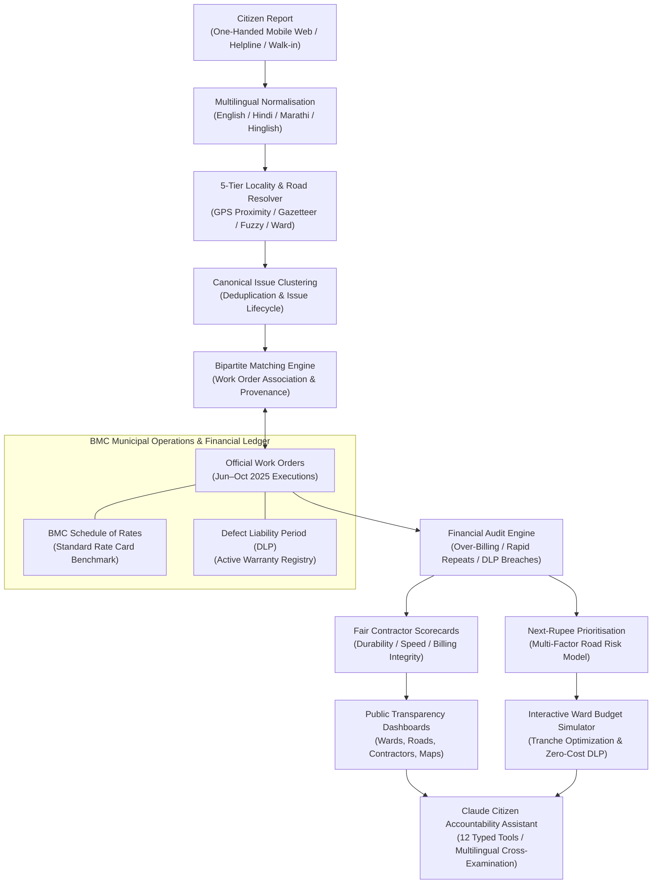
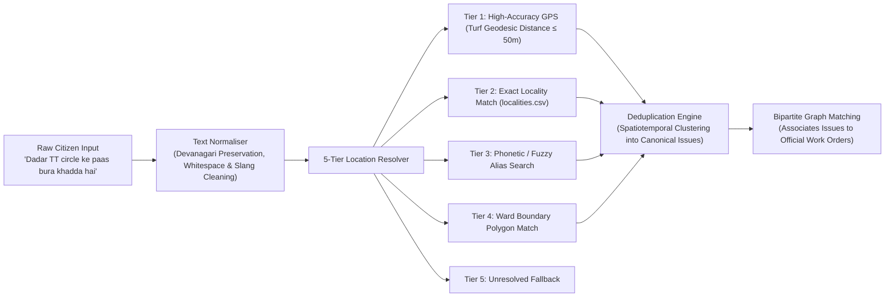

# Rastabaaz (रास्ता हिसाब)

> **Follow the Rupee across Mumbai's monsoon roads.**  
> A civic financial intelligence and public accountability platform connecting citizen pothole reports directly to municipal repair budgets, official work orders, contractor scorecards, and warranty enforcement across all 24 BMC wards.

[](https://nextjs.org/)
[](https://react.dev/)
[](https://www.typescriptlang.org/)
[](https://vitest.dev/)
[](https://ux4g.gov.in/)
[](https://maplibre.org/)
[](https://www.anthropic.com/)
[](https://aws.amazon.com/dynamodb/)
[](src/test/line-limit.test.ts)

---

## 🏛️ Executive Summary & The Mumbai Monsoon Reality

Every monsoon season, the streets of Mumbai suffer severe structural deterioration. The Brihanmumbai Municipal Corporation (BMC) allocates hundreds of crores of public rupees to emergency road repairs, pothole filling, mastic asphalt laying, and rapid concrete reinstatement. Yet, year after year:

1. **The Accountability Chasm:** Citizen complaints filed via helplines or mobile portals vanish into administrative queues without public visibility into which contractor was dispatched or how much money was spent.
2. **The Repeat-Repair Loop:** Potholes repaired in July frequently wash away by August, resulting in duplicate work orders billed to the municipal exchequer for the exact same road segment.
3. **Unenforced Warranties:** Roads legally covered under multi-year **Defect Liability Periods (DLP)**—where contractors are contractually obligated to fix failures for free—are repeatedly billed as fresh emergency repairs.

**Rastabaaz (रास्ता हिसाब)** bridges this gap. Built for citizens, civic activists, ward officers, and municipal leadership, Rastabaaz follows every single rupee from municipal allocation to the physical asphalt on the street.

> **Data Disclosure:** Rastabaaz is powered by the synthetic Mumbai civic dataset in `data/rupee/` (11,811 verified records across 15 relational CSVs and 2 GeoJSON boundaries). BMC ward boundaries (A through T), chronic flood hotspots, and 291 Mumbai road alignments are geographically authentic; financial sums, work order IDs, citizen reports, and contractor names are realistic synthetic constructs created for civic technology research and demonstration.

---

## 🔄 End-to-End Civic Accountability Pipeline

Rastabaaz establishes a deterministic, multi-stage pipeline connecting human street reporting to municipal audit registers:



---

## 📱 Platform Feature Architecture

| Route | Viewport & UX Focus | Purpose & Civic Capabilities |
| :--- | :--- | :--- |
| **`/`** | Mobile-First Report Form | Ergonomically engineered for one-handed phone use on the street. Step-by-step reporting with automatic canvas client-side photo compression, issue categorization, severity risk rating, location search, and interactive MapLibre pin-drop. |
| **`/map`** | Interactive GIS Map | High-performance MapLibre GL 6 vector map displaying all citizen road reports across Mumbai with cluster zooming, status filters, and direct links to ward financial dossiers. |
| **`/places/[slug]`** | Neighbourhood Feed | Localized aggregation of all reports filed within a specific locality (e.g., Dadar, Hindmata, Andheri East), chronologically sorted with ward spending summaries. |
| **`/reports/[id]`** | Individual Report & Road Trail | Detailed view of a citizen report. Features the **Road Trail Card**, which connects the reported coordinates to the underlying BMC road segment, displays active DLP warranty status, and reveals the historical repair ledger. |
| **`/wards`** | Citywide Financial Overview | Macro analysis comparing total monsoon budgets against actual expenditures across all 24 BMC wards (A, B, C, D, E, F/S, F/N, G/S, G/N, H/E, H/W, K/E, K/W, P/S, P/N, R/S, R/C, R/N, L, M/E, M/W, N, S, T). Sortable by overspend and audit flag volume. |
| **`/wards/[code]`** | Ward Intelligence Dossier | Complete ward deep-dive featuring: **Next-Rupee Prioritization** with an interactive **Budget Simulator**, repair durability by road material, flagged work orders, and **Assistant Commissioner Action Tools** (downloadable CSV audit registers and auto-generated show-cause/DLP enforcement memos). |
| **`/contractors`** | Contractor League Table | Citywide contractor ranking based on statistically normalized performance across durability, billing integrity, and speed. |
| **`/contractors/[id]`** | Contractor Accountability Dossier | Detailed contractor inspection: Claude-written plain-language executive summary, repeat failure rates, flagged billing events, ward distribution, and contract-by-contract performance. Includes vector PDF download. |
| **`/contractors/[id]/scorecard.pdf`** | Official Audit PDF | Programmatically rendered vector PDF scorecard generated via `pdf-lib` for administrative distribution, ward reviews, and citizen RTI (Right to Information) filings. |
| **`/assistant`** | Citizen Accountability Assistant | Conversational interface powered by Anthropic Claude (with deterministic fallback). Citizens can cross-examine municipal spending, track complaint status, inspect contractor track records, and discover next steps in English, Hindi, or Marathi. |
| **`/admin`** | Civic Desk & Review Queue | Administrative review desk for municipal moderators to inspect, verify, triage, and manage incoming citizen submissions. Protected by `ADMIN_KEY`. |

---

## 🔍 The Financial Intelligence & Audit Engine

Every municipal expenditure tracked in `src/lib/rupee/` is categorized into one of three strict outcomes:

$$\text{Total Ward Spend} = \text{Held Up} + \text{Failed within 30 Days (Re-opened)} + \text{Needs Explanation (Audit Flagged)}$$

### Automated Municipal Audit Rules

The audit engine runs programmatic rule validations against all 2,499 synthetic work orders:

```
┌────────────────────────────────────────────────────────────────────────────────────────┐
│ 1. RATE CARD PRICE GOUGING                                                             │
│    Billed Amount > 1.35 × (Repair Quantity × BMC Rate Card Unit Benchmark)              │
│    Flags contracts where unit billing exceeds standard municipal schedules by >35%.   │
├────────────────────────────────────────────────────────────────────────────────────────┤
│ 2. RAPID DUPLICATE BILLING (GHOST REPAIRS)                                             │
│    Identical Road ID + Same Repair Method billed within 7 days of previous completion, │
│    without an intervening citizen complaint logged in the interim.                     │
├────────────────────────────────────────────────────────────────────────────────────────┤
│ 3. DEFECT LIABILITY PERIOD (DLP) WARRANTY DOUBLE-BILLING                               │
│    Fresh BMC payment disbursed for a road segment currently covered under an active   │
│    contractor warranty. By municipal contract law, warranty defects must be fixed     │
│    at zero cost by the original contractor.                                            │
├────────────────────────────────────────────────────────────────────────────────────────┤
│ 4. POST-COMPLETION PHANTOM BURSTS (Optional via RUPEE_PHANTOM_FLAG=1)                  │
│    A sudden cluster of new citizen complaints registered on a road within 7 days of    │
│    a contractor filing official job completion.                                        │
└────────────────────────────────────────────────────────────────────────────────────────┘
```

---

## 🎯 Next-Rupee Prioritisation & Ward Budget Simulator

Rather than allocating funds via political discretion or arbitrary rotational quotas, Rastabaaz calculates an objective **Multi-Factor Risk Index** for every road segment:

$$\text{Risk Score} = 0.30 \cdot C_{\text{open}} + 0.25 \cdot R_{\text{reopen}} + 0.15 \cdot A_{\text{accidents}} + 0.15 \cdot F_{\text{flood}} + 0.10 \cdot T_{\text{traffic}} + 0.05 \cdot S_{\text{facility}}$$

Where:
- $C_{\text{open}}$: Open, unaddressed citizen complaints on the road segment.
- $R_{\text{reopen}}$: Frequency of historical repair failures within 30 days.
- $A_{\text{accidents}}$: Historical accident density and severity index.
- $F_{\text{flood}}$: Proximity to chronic monsoon flood hotspots and high-tide vulnerability.
- $T_{\text{traffic}}$: Peak vehicle density and public bus transit route importance.
- $S_{\text{facility}}$: Critical proximity to emergency hospital entry points and school zones.

### Interactive Tranche Budget Simulator
Embedded in every ward page (`/wards/[code]`), the simulator lets citizens and ward engineers dynamically adjust available funding tranches (e.g., ₹25 Lakh, ₹50 Lakh, ₹1 Crore, or Full Budget):
- Funds are allocated strictly in descending rank order of road risk.
- **The Zero-Cost DLP Advantage:** Roads under active Defect Liability are prioritized for immediate repair notice at **₹0 cost to the ward budget**, enforcing contractor accountability while conserving municipal funds.

---

## 📊 Fair Contractor Scorecard Methodology

Traditional government evaluations rely on raw complaint volumes, which unfairly penalize contractors assigned to flood-prone arterial roads with heavy container traffic. Rastabaaz applies statistical normalization:

1. **Method & Stress-Level Baselines:** Durability, speed, and billing metrics are benchmarked against citywide averages for the *exact same repair method* (e.g., Cold Mix, Mastic Asphalt, Paver Blocks, Micro-surfacing) under the *same road stress category*.
2. **Standardized Score Scale (0–100):**
   - **`50`**: Exactly at citywide expectation.
   - **`100`**: Flawless record (zero failures, zero billing flags, optimal SLA adherence).
   - **`< 35`**: Severely degraded performance (chronic repeat failures, excessive overbilling).
3. **Bayesian Shrinkage for Low-Sample Contractors:** Contractors with fewer than 15 historical work orders are statistically regularized toward the median score of `50` and labeled with a **`Limited Data`** badge, preventing small sample sizes from distorting rankings.

---

## 🤖 Claude Citizen Accountability Assistant

The assistant (`src/lib/assistant/`) provides a transparent, conversational cross-examination layer over municipal records.

### Architectural Guardrails: Claude Explains, It Does Not Count
- **Server-Only Execution:** Anthropic API keys are strictly kept on the server.
- **Zero Arbitrary Execution:** Claude has **no direct database access**, **no raw SQL execution**, and **no mutation rights**.
- **Deterministic Tool Calling:** Claude queries the municipal ledger solely through 12 typed, read-only tools:

```typescript
// Core Assistant Retrieval Tools (src/lib/assistant/tools/)
1. get_complaint(complaint_id)           // Inspect original citizen complaint details
2. get_canonical_issue(issue_id)          // Inspect clustered canonical civic issue
3. get_road_details(road_id)             // Fetch road length, surface, lanes, DLP status
4. get_work_orders(road_id, ward_code)   // Query historical work orders and billed costs
5. get_contractor_details(contractor_id) // Retrieve contractor grade, jobs, and audit flags
6. get_issue_timeline(issue_id)          // Complete audit chronology from report to repair
7. get_source_evidence(reference_id)     // Examine raw provenance records and ground truths
8. get_next_steps(issue_id)              // Actionable recommendations for citizen follow-up
9. get_contractor_rankings()             // League table of contractor scorecard metrics
10. get_ward_summary(ward_code)          // Financial summary and spend vs budget by ward
11. get_audit_flags(ward_code, type)     // List active municipal audit red-flags
12. get_next_rupee_plan(ward_code)       // Next-rupee road prioritisation rank order
```

### Structured Output Schema
Every assistant answer is validated against a strict schema before rendering to the user:
1. **Direct Answer:** Clear, jargon-free summary addressing the user's question.
2. **Official Records:** Concrete numbers, contractor names, work order dates, and amounts billed.
3. **Timeline So Far:** Chronological progression of municipal actions.
4. **Unresolved Questions:** Ambiguities or missing steps (e.g., unexplained price markups).
5. **Citizen Next Steps:** Concrete advice (e.g., how to request a DLP inspection or file a ward grievance).
6. **Sources Examined:** Explicit audit trail of record IDs inspected to formulate the response.

### Multilingual & Hinglish Support
Citizens can converse in English, Hindi (हिन्दी), Marathi (मराठी), or informal Hinglish ("Meri Hindmata road wali complaint ka kya hua?"). Without an API key, the assistant gracefully falls back to a deterministic, zero-dependency templated answer engine using the identical evidence retrieval logic.

---

## 🧭 Multilingual Complaint Intelligence & Linking Engine

Civic complaints logged through municipal call centers, WhatsApp groups, and mobile apps suffer from erratic spelling, localized street slang, and mixed scripts. The engine in `src/lib/matching/` resolves these challenges:



- **Script Preservation:** Hindi and Marathi Devanagari text is cleaned and preserved without lossy translation to English.
- **Strict Entity Separation:** Original complaint records are never overwritten or merged; they remain distinct and linked to a single canonical issue.
- **Traceable Provenance:** Every match record retains an explicit confidence score and resolution method (`gps_exact`, `alias_exact`, `fuzzy_alias`, `ward_default`), allowing the assistant and audit desk to distinguish between confirmed links and probabilistic associations.

---

## 🛠️ Tech Stack & System Architecture

```
┌────────────────────────────────────────────────────────────────────────┐
│                        FRONTEND PRESENTATION LAYER                     │
│  Next.js 15.5 (App Router, Server Actions, SSR) • React 19 • TypeScript │
│  UX4G 3.3.3 Design System (MeitY Government of India Standards)        │
│  MapLibre GL 6 (Vector GeoJSON Rendering & Canvas Pin Interactions)    │
│  Responsive Mobile Layouts (Stacked Tables, Dynamic Drawers, CSS Tabs) │
└───────────────────────────────────┬────────────────────────────────────┘
                                    │ Server Actions & Typed Routes
┌───────────────────────────────────▼────────────────────────────────────┐
│                        CORE APPLICATION DOMAIN                         │
│  src/lib/rupee/      Follow The Rupee Ledger, Audit Rules, Next-Rupee   │
│  src/lib/matching/   Locality Normaliser, Deduplicator & Linker        │
│  src/lib/assistant/  Claude Tool Sandbox, Retrieval & Response Validation│
│  src/lib/repo/       Abstract Persistence Port (In-Memory & DynamoDB) │
└───────────────────────────────────┬────────────────────────────────────┘
                                    │ Repository Abstraction
┌───────────────────────────────────▼────────────────────────────────────┐
│                         PERSISTENCE & COMPUTE                          │
│  Local Mode: Zero-Dependency Synchronous In-Memory Seed Store          │
│  Production: AWS DynamoDB (Single-Table Design, GSI Compound Keys)     │
│  Deployment: AWS Amplify Hosting (SSR Compute Engine, Node.js 20+)     │
│  AI Engine:  Anthropic Claude 3.5 Sonnet / Haiku SDK                   │
└────────────────────────────────────────────────────────────────────────┘
```

---

## 💻 Developer Quickstart

### Prerequisites
- **Node.js 20+** (`node -v` $\ge$ 20.0.0)
- **npm 10+**

### 1. Clone & Install
```bash
git clone https://github.com/di0206-innovator/claude-impact-labs---my-version.git
cd claude-impact-labs---my-version
npm ci
```

### 2. Run in Local In-Memory Mode (No AWS Required)
Rastabaaz includes a zero-config in-memory store that immediately seeds the application with sample citizen reports and the full Mumbai rupee ledger:

```bash
RASTABAAZ_REPO=memory npm run dev
```
Open [http://localhost:3000](http://localhost:3000) in your browser.

### 3. (Optional) Run with AWS DynamoDB
To connect to an AWS DynamoDB instance (or local DynamoDB emulator):
1. Configure AWS credentials and set `RASTABAAZ_TABLE_NAME` in `.env.local`.
2. Create the table using the CloudFormation template in `infra/rastabaaz-table.yaml`.
3. Seed the database:
   ```bash
   npm run seed
   npm run dev
   ```

### 4. (Optional) Enable Claude AI Assistant
Set your Anthropic API key in `.env.local`:
```bash
ANTHROPIC_API_KEY=sk-ant-api03-...
```

---

## ⚙️ Environment Variables Reference

| Variable | Scope | Required | Description |
| :--- | :--- | :---: | :--- |
| `ANTHROPIC_API_KEY` | Server | Optional | Anthropic API key for Claude assistant and contractor summaries. (`ANTHROPIC_AUTH_TOKEN` also supported). |
| `ANTHROPIC_MODEL` | Server | Optional | Assistant model. Defaults to `claude-sonnet-4-5`, with automatic fallback to `claude-haiku-4-5`. |
| `RUPEE_CONTRACTOR_MODEL`| Server | Optional | Contractor summary model. Defaults to `claude-haiku-5-5`. |
| `RUPEE_PHANTOM_FLAG` | Server | Optional | Set to `1` to activate experimental post-completion complaint spike audit check. |
| `RASTABAAZ_REPO` | Server | Optional | Set to `memory` for zero-dependency ephemeral in-memory storage during local development. |
| `RASTABAAZ_TABLE_NAME` | Server | Production | Name of the Amazon DynamoDB single-table database. |
| `AWS_REGION` | Server | Production | AWS Region for DynamoDB operations (e.g., `ap-south-1`). |
| `DYNAMODB_ENDPOINT` | Server | Optional | Custom HTTP endpoint for local DynamoDB instances (e.g., `http://localhost:8000`). |
| `AWS_PROFILE` | Server | Optional | Named AWS CLI profile for local authentication. |
| `ADMIN_KEY` | Server | Required | Secret passkey for accessing the `/admin` civic moderation desk. |
| `NEXT_PUBLIC_SITE_URL` | Client | Optional | Fully qualified public URL used for Open Graph and Twitter image resolution in production. |

---

## 📜 NPM Script Commands

| Command | Purpose |
| :--- | :--- |
| `npm run dev` | Starts the Next.js development server with Turbopack. |
| `npm run build` | Compiles the production build, optimizes assets, and generates static routes. |
| `npm start` | Launches the Next.js production server. |
| `npm run typecheck` | Executes `tsc --noEmit` to verify complete TypeScript strictness. |
| `npm run lint` | Runs ESLint across all source files. |
| `npm test` | Executes the complete Vitest automated test suite (93 test suites, 471+ tests). |
| `npm run test:lines` | **Architectural Guardrail:** Fails if any `.ts`, `.tsx`, `.css`, or `.mjs` file exceeds 300 lines. |
| `npm run seed` | Seeds the configured database (Memory or DynamoDB) with synthetic baseline reports. |
| `node scripts/build-geo.mjs`| Rebuilds runtime GeoJSON geometries in `src/lib/geo-data/` from source CSVs in `data/rupee/`. |
| `npm run amplify:env` | Generates `.env.production` during AWS Amplify CI/CD deployments. |
| `npm run iam:policy` | Renders a least-privilege, table-scoped IAM policy for cloud compute roles. |

---

## 📂 Repository Structure

```
├── data/rupee/                    # Full synthetic civic dataset (15 CSVs + 2 GeoJSONs)
│   ├── DATA_DICTIONARY.md         # Schema definitions for complaints, roads, contractors, etc.
│   ├── STARTER_IDEAS.md           # Civic accountability problem statements and use cases
│   └── [complaints, roads, wards, work_orders, contractors, traffic, ...]
├── docs/architecture/             # Architectural records and dataset quality reports
│   └── data-quality-report.md     # Relational integrity and data validation audit
├── infra/                         # Cloud infrastructure definitions
│   ├── rastabaaz-table.yaml       # AWS CloudFormation single-table DynamoDB template
│   └── README.md                  # Infrastructure deployment and IAM guidelines
├── scripts/                       # Build scripts and tooling
│   ├── build-geo.mjs              # GeoJSON coordinate compiler
│   ├── copy-maplibre-worker.mjs   # Standalone web worker packager for MapLibre
│   ├── render-iam-policy.ts       # Least-privilege IAM policy generator
│   └── write-amplify-env.ts       # Amplify cloud environment builder
├── src/
│   ├── app/                       # Next.js 15 App Router pages and API routes
│   │   ├── assistant/             # Citizen AI accountability chat interface
│   │   ├── contractors/           # Contractor league table and [id] dossiers
│   │   ├── map/                   # Citywide interactive GIS pin map
│   │   ├── places/                # Locality-specific report feeds
│   │   ├── reports/               # Citizen report view & Road Trail card
│   │   └── wards/                 # Ward spend dossiers and next-rupee simulator
│   ├── components/                # Modular React 19 UI components (≤ 300 lines each)
│   │   ├── assistant/             # Chat composer, answers, and structured fact chips
│   │   ├── map/                   # MapLibre GL wrapper, layers, and interactive controls
│   │   ├── report/                # Step-by-step mobile report form & photo compressor
│   │   ├── rupee/                 # Budget simulator, contractor scorecard, audit lists
│   │   └── site/                  # Navigation header, footer, and government banners
│   ├── lib/                       # Domain engines and business logic
│   │   ├── assistant/             # Claude agent orchestration, typed tools, and schemas
│   │   ├── matching/              # Complaint deduplication, normalisation & road linking
│   │   ├── repo/                  # Persistence port with Memory and DynamoDB adapters
│   │   └── rupee/                 # Ledger computations, audit checks, risk scoring
│   ├── styles/                    # UX4G 3.3.3 theme extensions and responsive CSS
│   └── test/                      # 93 Vitest unit, integration, and security test suites
```

---

## 🛡️ Security, Privacy & Public Integrity

1. **Zero Personally Identifiable Information (PII):** Complainant identifiers in the dataset are cryptographically hashed; contact details are never logged or stored.
2. **Server-Only LLM Boundaries:** Claude credentials and reasoning tools execute exclusively in server-side runtimes. No API keys or internal tool definitions are ever leaked to client bundles.
3. **Strict 300-Line Codebase Hygiene:** Every file across the codebase is bound to a hard 300-line limit verified on every commit (`npm run test:lines`). This prevents architectural drift, guarantees high cohesion, and simplifies independent security audits.
4. **Least-Privilege Cloud IAM:** The DynamoDB access layer restricts read/write permissions strictly to the application table name (`infra/rastabaaz-table.yaml`), disallowing broad AWS account privileges.

---

## 🚀 Cloud Deployment (AWS Amplify Hosting)

Rastabaaz deploys seamlessly to **AWS Amplify Hosting** with Next.js 15 SSR support:

1. Connect the GitHub repository in the AWS Amplify Console.
2. Select the `rasta-hisaab` (or `main`) branch.
3. Amplify automatically detects `amplify.yml`:
   ```yaml
   frontend:
     phases:
       preBuild:
         commands:
           - npm ci
           - npm run amplify:env
       build:
         commands:
           - npm run build
   ```
4. Configure environment variables in the Amplify Console:
   - `RASTABAAZ_TABLE_NAME`: Target DynamoDB table.
   - `ADMIN_KEY`: Desk administration secret.
   - `ANTHROPIC_API_KEY`: (Optional) Claude API key.
   - `NEXT_PUBLIC_SITE_URL`: Production domain URL.
5. Deploy and attach a custom domain.

---

## ⚖️ License & Civic Mission

This project is open-source under the **MIT License**. Built as an initiative for transparency, civic intelligence, and public infrastructure accountability in Mumbai.
