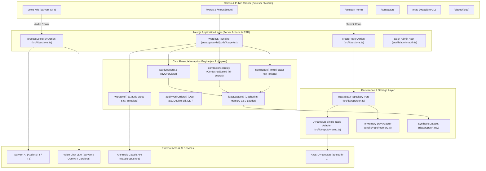

# Rasta Hisaab / Rastabaaz — Current System Map & Architecture Specification

**Status:** Current Architecture as of Branch `rasta-hisaab` (Commit `e124cd9`)  
**Scope:** Component Topology, Data Pipelines, Persistence Contracts, and Interface Boundaries.

---

## 1. System Topology Overview

Rastabaaz is an event-driven, server-rendered civic intelligence platform built with Next.js 15 App Router, React 19 Server/Client Components, Tailwind CSS 4, and UX4G 3.3.3.

---

## 2. Core Subsystems

### 2.1 Citizen Reporting Subsystem
- **Entry Points:** `/` (Home page) and `/report/new`.
- **Form Architecture:** `ReportForm` -> `ReportDraft` (`src/components/report/ReportDraft.tsx`).
- **Steps:**
  1. `photo` (Step 1): Uses HTML5 file input, client-side canvas compression (`src/lib/photo-compress.ts`) ensuring image size < 200KB before upload.
  2. `issue` (Step 2): Citizen selects road issue type (`"pothole" | "waterlogging" | "open_manhole" | "choked_drain" | "road_cave_in" | "broken_paver_blocks" | "other"`).
  3. `history` (Step 3): Noticed window selection (`"today" | "this_week" | "this_month" | "one_to_six_months" | "over_six_months"`), and recurrence boolean (`recurs`).
  4. `impact` (Step 4): Safety impact observation (`"injury" | "near_miss" | "none" | "not_sure"`).
  5. `place` (Step 5): Location pinning with MapLibre GL map, quick picks for Mumbai flood points, or search across 118 localities. Geocoding automatically snaps to nearest road within 250m (`nearestRoad`) and ward polygon (`wardAt`).
  6. `review` (Step 6): Human-controlled verification screen ("Check") displaying all captured details before triggering `createReportAction`.
- **Voice Mode (`AnswerModeToggle`):** Enables two-way conversational data entry through Sarvam speech-to-text, tool-call extraction, and audio response, while maintaining human confirmation at Step 6.

### 2.2 Financial Analytics Engine (`src/lib/rupee/`)
- **Data Loading (`load.ts`):** Parses 11 CSV files from `data/rupee/` on application initialization, cached as a process singleton (`Dataset`).
- **Audit Rules (`audit.ts`):**
  - `over_rate`: Flags work orders where `costInr > expectedCostInr * 1.35`. Expected cost is computed from `rate_card.csv` (`areaSqm * rateInr` for sqm methods or `standard_rate_inr` for per-job methods).
  - `double_billed`: Flags work orders with no linked complaints if another work order exists on the same road with the same repair method completed within 0 to 7 days.
  - `paid_under_dlp`: Flags work orders executed on road segments flagged as `under_dlp = Y` in `roads.csv`.
- **Ledger & Budget Outcomes (`ledger.ts`):**
  Partitions each ward's expenditure into three mutually exclusive buckets:
  1. `flaggedInr`: Work orders carrying one or more audit flags.
  2. `failedInr`: Non-flagged work orders that failed within 30 days (`reopened_within_30d = Y`).
  3. `heldInr`: Non-flagged work orders that held up past 30 days.
- **Contractor Fairness Scorecards (`contractors.ts`):**
  Adjusts durability expectations by grouping citywide work orders into `workType | flood_band` baselines (where `flood_band` is categorized from ward `low_lying_index`: low < 0.4, mid 0.4-0.65, high > 0.65). Contractor reopen rates are evaluated against this expected rate to prevent penalizing contractors handling high volumes of difficult flood-zone repairs.
- **Next-Rupee Prioritisation (`next-rupee.ts`):**
  Ranks ward roads for repair allocation based on a weighted multi-factor risk score (0-100):
  - Open complaints without work orders: Weight 25
  - Reopened fixes within 30 days: Weight 20
  - Historical accidents on road: Weight 15
  - Flood hotspot proximity (< 400m): Weight 15
  - Traffic congestion index & bus routes: Weight 10
  - Critical facilities (hospitals/schools) using road: Weight 15
  - Recommends the most durable historical repair method and estimates cost based on rate-card rates and median repair area.
- **Claude Ward Briefs (`brief.ts`):**
  Assembles computed ledger facts, contractor highlights, and next-rupee recommendations into a structured prompt for Claude (`claude-opus-5-5`), generating a 90-130 word plain English summary for citizens and corporators. Falls back to deterministic template when API credentials are not provided.

### 2.3 Spatial Clustering & Geocoding (`src/lib/geo.ts`, `src/lib/city.ts`)
- **Spatial Resolution:**
  - Cluster Grid: `CLUSTER_GRID = 0.00028` degrees (~31m).
  - Matching Radius: `MATCH_METERS = 40`m.
  - Road Snapping: `ROAD_METERS = 250`m.
  - Locality Gazetteer: 118 localities in `src/lib/geo-data/localities.data.json`.
  - Boundary Polygons: 24 synthetic ward Voronoi polygons in `src/lib/geo-data/wards.data.json`.
- **Place Deduplication (`resolvePlace` in `src/lib/repo/place-resolve.ts`):**
  - Evaluates whether a new citizen pin falls within 40m of an existing place *with the same issue type*.
  - Uses DynamoDB transactional slot locking (`placeLockItem`) across 4 slots to avoid race conditions when simultaneous reports are submitted in the same grid cell.

---

## 3. DynamoDB Single-Table Schema Contract

The repository uses a single-table design (`infra/rastabaaz-table.yaml`):

### Key Hierarchy

| Entity | PK | SK | GSI1PK | GSI1SK | GSI2PK | GSI2SK | byType (PK) |
| :--- | :--- | :--- | :--- | :--- | :--- | :--- | :--- |
| **Location (Place)** | `LOC#<id>` | `META` | `SLUG#<slug>` | `LOC` | `GEO#<clusterKey>` | `LOC#<id>` | `location` |
| **Place Slug Lock** | `SLUG#<slug>`| `LOCK` | — | — | — | — | — |
| **Place Geo Lock** | `LOCK#<grid>#<slot>` | `LOCK` | — | — | — | — | — |
| **Report Meta** | `RPT#<id>` | `META` | `LOC#<locationId>` | `RPT#<noticedAt>` | — | — | `report` |
| **Report Photo** | `RPT#<id>` | `PHOTO` | — | — | — | — | — |
| **Desk Note** | `NOTE#<id>` | `META` | `RPT#<reportId>` | `NOTE#<createdAt>` | — | — | `note` |
| **Seed Marker** | `SEED#marker` | `META` | — | — | — | — | — |

### Indexes
- **Primary Key:** `pk` (HASH) + `sk` (RANGE) — Strongly consistent reads for direct entity lookups.
- **GSI1:** `gsi1pk` + `gsi1sk` — Place slug lookups (`/places/[slug]`), and reports by location ordered by date.
- **GSI2:** `gsi2pk` + `gsi2sk` — Spatial clustering lookups by geohash/grid key (`findNearbyLocation`).
- **byType:** `type` (HASH) + `pk` (RANGE) — Project metadata index for catalog building and seeding.

---

## 4. Interfaces & Extension Points for Future Modules

The following extension points are designed to accommodate future modules without breaking the existing architecture:

| Future Module | Integration Point | Clean Interface Contract |
| :--- | :--- | :--- |
| **Complaint Normalisation & Deduplication** | `src/lib/rupee/complaints.ts` (new) | Reads raw `ds.complaints`, maps messy categories to `IssueType`, groups near-identical complaints into canonical clusters. |
| **Canonical Issue Generation** | `src/lib/rupee/canonical.ts` (new) | Exports `CanonicalIssue` bridging BMC complaints, social posts, and live citizen reports with shared coordinates and road IDs. |
| **Road-Segment Matching (Non-GPS)** | `src/lib/place-name.ts` (extend) | Extends `nearestRoad` with text gazetteer matching against `roads.csv` and `localities.csv` for the 41.9% non-GPS complaints. |
| **Work-Order Association** | `src/lib/rupee/work-orders.ts` (new) | Augments `work_orders.csv` `linked_complaint_ids` with spatial-temporal inferred associations for unlinked complaints. |
| **Citizen Issue Timelines** | `src/lib/types.ts` (`PlaceHistoryEvent`) | Aggregates complaint logged -> citizen photo added -> work order issued -> repair completed -> post-repair status. |
| **Claude Accountability Tools** | `src/lib/rupee/tools.ts` (new) | Implements tool schemas (`query_ward`, `query_contractor`, `audit_order`) callable by Claude for citizen Q&A. |
| **Multilingual Citizen Q&A** | `src/lib/voice/` & `src/app/api/ask/` | Supports natural language queries in Marathi (`mr`), Hindi (`hi`), and Hinglish (`hi-en`) using the existing Sarvam/Claude pipeline. |
